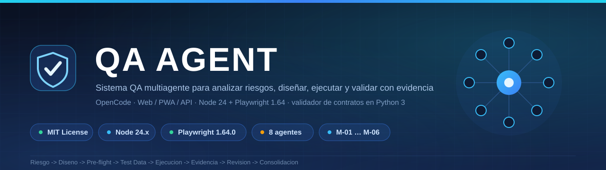
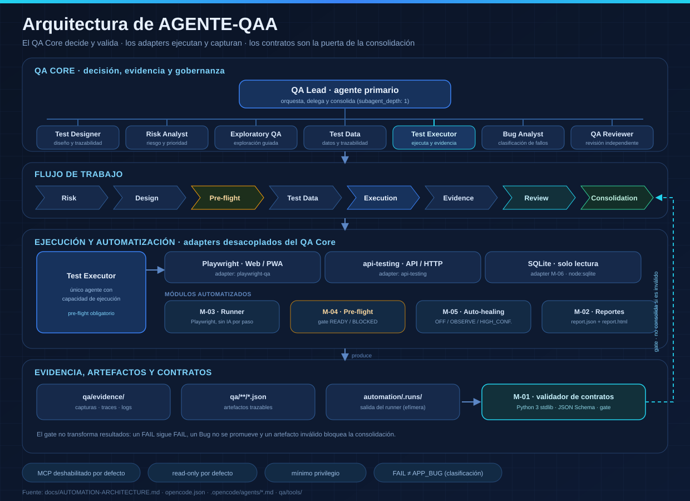
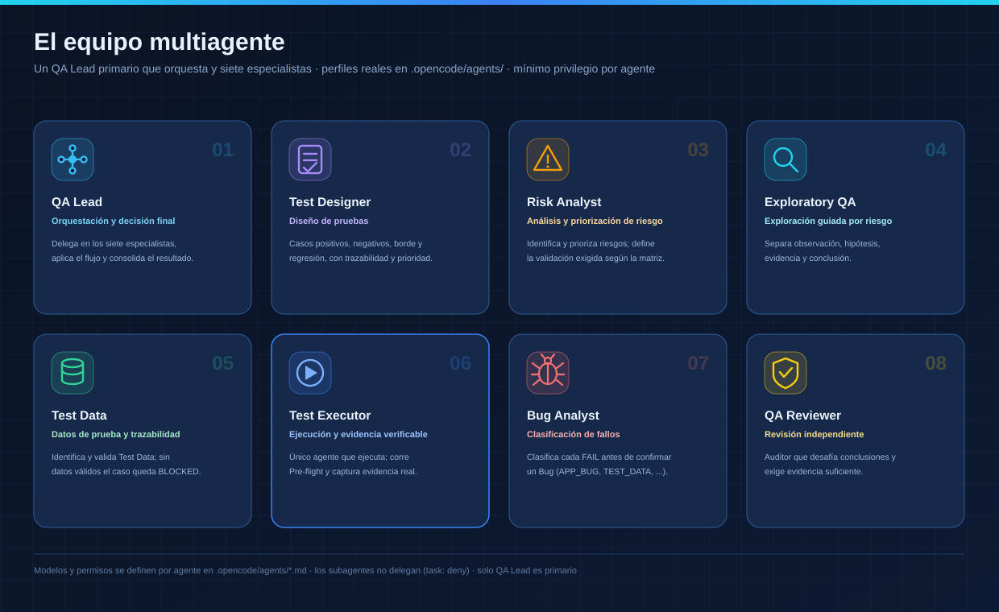

<a name="top"></a>



**Navegación:** [¿Qué es?](#que-es) · [Capacidades](#capacidades) · [Arquitectura](#arquitectura) · [Equipo](#equipo) · [Módulos](#modulos) · [Requisitos](#requisitos) · [Primeros pasos](#primeros-pasos) · [Comandos](#comandos) · [Estructura](#estructura) · [Modos de reporte](#modos-de-reporte) · [Documentación](#documentacion) · [Alcance](#alcance) · [Licencia](#licencia)

---

<a name="que-es"></a>
## ¿Qué es AGENTE-QAA?

AGENTE-QAA es una **base de infraestructura para un sistema de QA multiagente** que corre dentro de [OpenCode](https://opencode.ai). Un agente primario (`qa-lead`) coordina siete especialistas y aplica un proceso **guiado por riesgo y por evidencia**: entender → planificar → evaluar riesgo → diseñar pruebas → pre-flight → test data → ejecutar/explorar → analizar evidencia → clasificar fallos → revisión independiente → retest/regresión → reporte final.

Resuelve un problema concreto: que *una herramienta termine sin error* no se confunda con *la prueba pasó* ni con *el resultado está validado*. El sistema separa explícitamente **expected / observed / evidence / conclusion / confidence**, clasifica cada FAIL antes de declarar un Bug y exige una **revisión independiente** para las conclusiones críticas.

**Principios rectores**

- **NO EVIDENCE = NO CONFIRMED RESULT.**
- Diferenciar `herramienta invocada → herramienta OK → resultado obtenido → resultado validado`.
- **FAIL ≠ APP_BUG**: cada FAIL pasa por *Failure Classification* (`APP_BUG` / `TEST_DATA` / `TEST_INFRASTRUCTURE` / `BLOCKED` / `INSUFFICIENT_EVIDENCE`) antes de confirmar un Bug.
- Nunca se inventan datos de prueba: si falta o no se puede validar, el Test Case queda **BLOCKED**.
- Los adapters (Playwright, api-testing) están **desacoplados** del QA Core, que decide y valida.
- Mínimo privilegio y lectura por defecto.
- El sistema responde en el **idioma del usuario**.

---

<a name="capacidades"></a>
## Capacidades principales

- **Orquestación multiagente**: un agente primario que delega en siete especialistas, sin delegación en cadena.
- **Diseño de pruebas**: casos positivos, negativos, de borde y de regresión, con trazabilidad y prioridad por riesgo.
- **Análisis de riesgo**: identificación, evaluación y priorización; la validación escala con el impacto y el riesgo.
- **Test Data**: identificación, validación y trazabilidad; estados `AVAILABLE` / `MISSING` / `INVALID` / `EXPIRED` / `CONSUMED` / `UNVERIFIED` / `NOT_APPLICABLE`.
- **Ejecución controlada**: Pre-flight obligatorio antes de correr y captura de evidencia verificable.
- **Contratos verificables por máquina** (**M-01**): JSON Schemas + validador en Python 3 stdlib que actúa como *gate*.
- **Automatización desacoplada** (**M-03**): runner reusable sobre Playwright Test (Web + API), **sin IA por paso** y **sin tokens** en la corrida.
- **Reportes por corrida** (**M-02**): `report.json` + `report.html` derivado del JSON.
- **Auto-healing con guardrails** (**M-05**): modos `OFF` / `OBSERVE` / `HIGH_CONFIDENCE`, sin ocultar defectos.
- **Verificación de datos** (**M-06**): adapter de base de datos **solo lectura** (SQLite vía `node:sqlite`).
- **Revisión independiente**: `qa-reviewer` audita y desafía las conclusiones críticas.
- **Modos de reporte** `FAST` (por defecto) y `DETAIL`.
- **Health check**: script que verifica agentes, skills, herramientas y configuración.
- **Tests de integración**: verifican que el flujo completo de agentes produzca artefactos válidos.

---

<a name="arquitectura"></a>
## Arquitectura



El **QA Core decide y valida**; los **adapters ejecutan y capturan**. `qa-lead` es el único agente primario (`default_agent` en `opencode.json`) y el único que delega: su permiso `subagent` habilita a los siete especialistas. Los subagentes tienen `subagent: deny` y no existe delegación en cadena.

- **QA Core (decisión):** `qa-lead` + `test-designer`, `risk-analyst`, `exploratory-qa`, `test-data`, `test-executor`, `bug-analyst`, `qa-reviewer`.
- **Flujo:** Risk → Design → Pre-flight → Test Data → Execution → Evidence → Review → Consolidation.
- **Ejecución:** `test-executor` es el único agente con capacidad de ejecución; usa los adapters (Playwright para Web/PWA, `api-testing` para API/HTTP) y los módulos M-02…M-06.
- **Evidencia y contratos:** la evidencia (`qa/evidence/`) y los artefactos (`qa/**/*.json`, la salida del runner) se validan con **M-01**, que es un *gate*: nunca transforma un resultado y **bloquea la consolidación** si un artefacto no cumple su contrato.

Configuración relevante (`opencode.json`): `default_agent: qa-lead`, `external_directory: deny` y MCP deshabilitado (`context7.disabled: true`).

---

<a name="equipo"></a>
## El equipo multiagente



| Agente | Tipo | Responsabilidad principal |
| --- | --- | --- |
| `qa-lead` | primario | Orquesta el flujo, delega y consolida la decisión final. |
| `test-designer` | subagente | Diseña Test Cases, cobertura y trazabilidad. |
| `risk-analyst` | subagente | Identifica, evalúa y prioriza riesgos. |
| `exploratory-qa` | subagente | Exploración guiada por riesgo (observación ≠ hipótesis ≠ conclusión). |
| `test-data` | subagente | Identifica y valida Test Data; reporta BLOCKED por datos. |
| `test-executor` | subagente | Único agente con ejecución; Pre-flight + evidencia verificable. |
| `bug-analyst` | subagente | Analiza fallos y aplica Failure Classification. |
| `qa-reviewer` | subagente | Auditor independiente que desafía las conclusiones. |

Los perfiles reales (modelo y permisos por agente) viven en `.opencode/agents/*.md`.

---

<a name="modulos"></a>
## Módulos M-01 … M-06

| Módulo | Qué aporta | Estado | Artefacto principal |
| --- | --- | --- | --- |
| **M-01** | Validación de contratos con JSON Schema (Python 3 stdlib); *gate*, no decisor. | Implementado | `qa/tools/validate_contracts.py`, `qa/schema/` |
| **M-02** | Reportes de ejecución `report.json` + `report.html` por corrida. | Implementado | `automation/runner/report.ts` |
| **M-03** | Runner reusable (Playwright Test, Web + API), sin IA por paso ni tokens. | Implementado | `automation/runner/runner.ts` |
| **M-04** | Pre-flight ejecutable: `READY` / `BLOCKED` según capacidades requeridas. | Implementado | `qa/tools/preflight.py` |
| **M-05** | Auto-healing con guardrails (`OFF` / `OBSERVE` / `HIGH_CONFIDENCE`). | Implementado | `automation/runner/healed.ts` |
| **M-06** | Verificación de datos SQLite de **solo lectura**, declarada por la suite. | Implementado | `automation/runner/sqlite-adapter.ts` |

Detalle técnico de cada módulo: `docs/AUTOMATION-ARCHITECTURE.md` y los documentos enlazados más abajo.

---

<a name="requisitos"></a>
## Requisitos

| Requisito | Versión / Detalle |
| --- | --- |
| Node.js | **24.x** (`engines`: `>=24.0.0 <25.0.0`; `.nvmrc`: `24.21.0`) |
| npm | `>=11` (verificado con 11.19.0) |
| Python | 3.x — **solo stdlib** para las herramientas del QA Core (`qa/tools/`) |
| Playwright | `@playwright/test` **1.64.0** + Chromium |
| TypeScript | 5.9.3 (runner M-03) |
| OpenCode | para ejecutar los agentes y skills |

`.npmrc` usa `engine-strict=true`: la instalación falla si la versión de Node no cumple `engines`.

---

<a name="primeros-pasos"></a>
## Primeros pasos con OpenCode

1. Verificá los modelos disponibles:
   ```bash
   opencode models
   ```
2. Abrí este repositorio en OpenCode.
3. El agente primario por defecto es `qa-lead` (`opencode.json`).
4. Pedile a `qa-lead` que **inspeccione el sistema bajo prueba** antes de ejecutar tests.
5. El flujo, la clasificación de fallos, la interfaz de ayuda y los modos de reporte están definidos en `AGENTS.md` y `docs/`.

No se requiere MCP: está deshabilitado por defecto y el QA Core no depende de él.

---

<a name="comandos"></a>
## Comandos de ejecución, pruebas y validación

**Instalación y verificación del entorno**

```bash
npm ci                     # instalación reproducible desde package-lock.json
npm run verify:env         # 5 checks: Node, npm, @playwright/test, Chromium y lockfile
npm run health:check       # health check del sistema (agentes, skills, tools)
npm run browsers:install   # instala Chromium (si hace falta)
```

**Calidad y build**

```bash
npm run typecheck          # tsc --noEmit
npm run build:runner       # compila el runner M-03 -> automation/.dist
```

**Tests del runner (Playwright)**

```bash
npm test                   # 59 tests: infra.smoke (2) + runner.infra (32) + sqlite-adapter (25)
npm run test:smoke         # solo el smoke de infraestructura
```

**Tests de integración (Python)**

```bash
npm run test:integration    # 10 tests de integración multiagente
```

> Los tests validan que los artefactos de cada agente cumplan sus contratos M-01. La demo `tests/integration/demo_e2e_flow.py` usa artefactos simulados. Ninguno demuestra por sí mismo colaboración real entre los ocho agentes.

**Suites demo (sin IA, contra app local aislada)**

```bash
npm run suite:demo-web     # 2 TC -> automation/.runs/suite-demo-web/report.{json,html}
npm run suite:demo-api     # 2 TC -> automation/.runs/suite-demo-api/report.{json,html}
```

**QA Core en Python (stdlib)**

```bash
# Pruebas automatizadas de las herramientas (127 tests en total)
python qa/tools/test_validate_contracts.py   # 39 tests (M-01)
python qa/tools/test_preflight.py            # 48 tests (M-04)
python qa/tools/test_data_verification.py    # 14 tests (M-06)
python qa/tools/test_report_generator.py     # 14 tests (M-02)
python qa/tools/test_render_qa_report.py     # 12 tests (renderizador)

# Validación de contratos sobre un bundle de artefactos
python qa/tools/validate_contracts.py --bundle qa/ --json

# Pre-flight de capacidades (exit 0 = READY, 1 = BLOCKED, 2 = fatal)
python qa/tools/preflight.py --requirements qa/tools/fixtures/preflight/requirements_demo_web.json
```

> El runner **no decide**: no clasifica un FAIL ni confirma un Bug. Esa responsabilidad es de `bug-analyst` (Failure Classification) y `qa-reviewer` (revisión independiente).

---

<a name="estructura"></a>
## Estructura de carpetas

```text
.
├─ .opencode/
│  ├─ agents/            # 8 perfiles de agente (qa-lead primario + 7 subagentes)
│  └─ skills/            # 11 procedimientos reutilizables (SKILL.md)
├─ automation/           # Base de automatización (Node + Playwright), desacoplada del QA Core
│  ├─ fixtures/          # App demo aislada (sin red externa ni credenciales)
│  ├─ manifests/         # Suites declarativas (demo Web/API, auto-healing)
│  ├─ runner/            # Runner M-03 + reportes M-02 + auto-healing M-05 + SQLite M-06
│  ├─ scripts/           # verify-env, health-check, servidores demo, base SQLite demo (M-06)
│  ├─ specs/             # Especificaciones Playwright
│  └─ tests/             # Tests de infraestructura del runner
├─ docs/                 # Contratos, arquitectura, políticas y docs por módulo
│  └─ assets/            # Recursos gráficos del README (banner y diagramas)
├─ qa/                   # QA Runtime Data (gobernanza en Python + JSON)
│  ├─ schema/            # JSON Schemas de los contratos (M-01)
│  ├─ tools/             # Validador, pre-flight, renderizador, logger y sus pruebas
│  ├─ evidence/          # Evidencia: capturas, traces, logs, console, network
│  ├─ bugs/  reports/  memory/
│  └─ tests/             # Artefactos QA de referencia (fixtures genéricos)
├─ tests/                # Definiciones de Test Case (raíz)
│  └─ integration/       # Tests de integración multiagente
├─ AGENTS.md             # Reglas del sistema (flujo, clasificación, idioma, UI, modos)
├─ opencode.json         # default_agent, permisos y MCP
├─ MANIFEST.json         # Inventario del repositorio
├─ CHANGELOG.md          # Historial de cambios
├─ CONTRIBUTING.md       # Guía de contribución
└─ package.json · playwright.config.ts · tsconfig.json · MCP.md
```

---

<a name="modos-de-reporte"></a>
## Modos de reporte: FAST y DETAIL

`REPORT_MODE: FAST` (por defecto) y `REPORT_MODE: DETAIL` cambian **solo la presentación y la profundidad** del reporte. No cambian los Test Cases ejecutados, los resultados, la Failure Classification, los Bugs, el riesgo, la evidencia ni la confianza. `BLOCKED` y `NOT VERIFIED` siempre se preservan. El *tipo* de prueba (smoke, regresión, etc.) depende del objetivo y el alcance, no del modo.

El reporte **FAST** abre con una conclusión en lenguaje claro (qué se probó, qué funcionó, qué problemas se encontraron, qué quedó sin verificar y dónde está el reporte HTML cuando se pidió o generó) y prioriza las verificaciones esenciales del alcance solicitado; solo agrega repeticiones, cruces o revisiones extra cuando resuelven una incertidumbre concreta o confirman un posible defecto. **DETAIL** conserva el análisis ampliado, el detalle técnico y las explicaciones para investigar los resultados. Especificación completa: `docs/REPORT-MODES.md`.

El **reporte HTML** comparte la jerarquía canónica única definida en `docs/REPORT-MODES.md` (Resumen ejecutivo → Métricas → Alcance → Pre-flight → Resultados → Datos de prueba → Clasificación de fallos → Bugs → Riesgos → Sin verificar / Bloqueado → Evidencia → Trazabilidad / adapters → Retest / Regresión → QA Reviewer → Conclusión, con las secciones opcionales solo cuando tienen datos) y se genera desde un modelo JSON con el renderizador reutilizable `qa/tools/render_qa_report.py`. El mismo modelo produce el reporte HTML (`--out`) y el resumen ejecutivo del chat (`--summary`), las métricas se derivan del detalle (los contadores y el **riesgo máximo** no pueden contradecir las secciones) y los enlaces de evidencia apuntan a archivos reales, señalando cuándo son locales.

---

<a name="documentacion"></a>
## Documentación

| Documento | Contenido |
| --- | --- |
| [`AGENTS.md`](AGENTS.md) | Reglas del sistema: agentes, flujo, clasificación, idioma, UI y modos. |
| [`docs/AGENT-CONTRACTS.md`](docs/AGENT-CONTRACTS.md) | Contratos de todos los artefactos QA. |
| [`docs/CONTRACTS-VALIDATION.md`](docs/CONTRACTS-VALIDATION.md) | Validación de contratos (**M-01**). |
| [`docs/AUTOMATION-ARCHITECTURE.md`](docs/AUTOMATION-ARCHITECTURE.md) | Arquitectura objetivo de automatización. |
| [`docs/RUNNER-M03.md`](docs/RUNNER-M03.md) | Runner reusable y reportes (M-03 / M-02). |
| [`docs/PRE-FLIGHT-CAPABILITIES.md`](docs/PRE-FLIGHT-CAPABILITIES.md) | Pre-flight (**M-04**). |
| [`docs/AUTO-HEALING.md`](docs/AUTO-HEALING.md) | Auto-healing con guardrails (**M-05**). |
| [`docs/DATA-VERIFICATION.md`](docs/DATA-VERIFICATION.md) | Verificación de datos SQLite (**M-06**). |
| [`docs/REPORT-MODES.md`](docs/REPORT-MODES.md) | Modos `FAST` / `DETAIL`. |
| [`docs/VALIDATION-POLICY.md`](docs/VALIDATION-POLICY.md) | Evidencia, confianza y matriz de riesgo. |
| [`docs/PLATFORM-ADAPTERS.md`](docs/PLATFORM-ADAPTERS.md) | Adapters por plataforma (Web, PWA, API, Hybrid). |
| [`docs/USER-INTERFACE.md`](docs/USER-INTERFACE.md) | Interfaz de ayuda (Welcome / HELP). |
| [`docs/QA-SYSTEM-AUDIT.md`](docs/QA-SYSTEM-AUDIT.md) · `docs/QA-SYSTEM-STABILITY-AUDIT.md` | Auditorías del sistema. |
| [`CHANGELOG.md`](CHANGELOG.md) | Historial de cambios. |
| [`CONTRIBUTING.md`](CONTRIBUTING.md) | Guía de contribución. |
| [`automation/README.md`](automation/README.md) · `qa/README.md` | Guías de la base de automatización y de los datos QA. |

---

<a name="alcance"></a>
## Alcance actual y limitaciones conocidas

- **Plataformas MVP:** **Web** y **PWA**; **API/HTTP** con el adaptador `api-testing`. **Hybrid** y **Native** están planificados, no implementados.
- **Es infraestructura**: no incluye una aplicación de producto publicada ni generación de código. La app demo es un *fixture* local aislado para las suites demo.
- **CI (GitHub Actions)**: `.github/workflows/ci.yml` corre en `push` a `main` y en pull requests e incluye `npm ci`, Chromium de Playwright, `npm run typecheck`, `npm test` (59), las pruebas Python (127), `npm run test:integration` (10) y `npm run demo` (suites Web y API). Los comandos se validaron localmente; el resultado de la corrida en GitHub se confirma al publicar.
- **MCP deshabilitado** por defecto; el sistema no depende de MCP.
- El runner **no decide**: no clasifica FAIL ni confirma Bugs (eso es de `bug-analyst` y `qa-reviewer`).
- La calidad de los modelos LLM no está validada (ver `docs/QA-SYSTEM-AUDIT.md`); las capacidades se contrastan con código y corridas no destructivas.
- La captura del reporte proviene de la suite demo Web local, sin red externa.
- No se versionan artefactos regenerables: `node_modules/`, `automation/.dist/`, `automation/.runs/`, `automation/.artifacts/` y logs.

---

<a name="licencia"></a>
## Licencia

Distribuido bajo la **MIT License**. Ver [`LICENSE`](LICENSE) para el texto completo.

© 2026 Francisco Ruiz.
